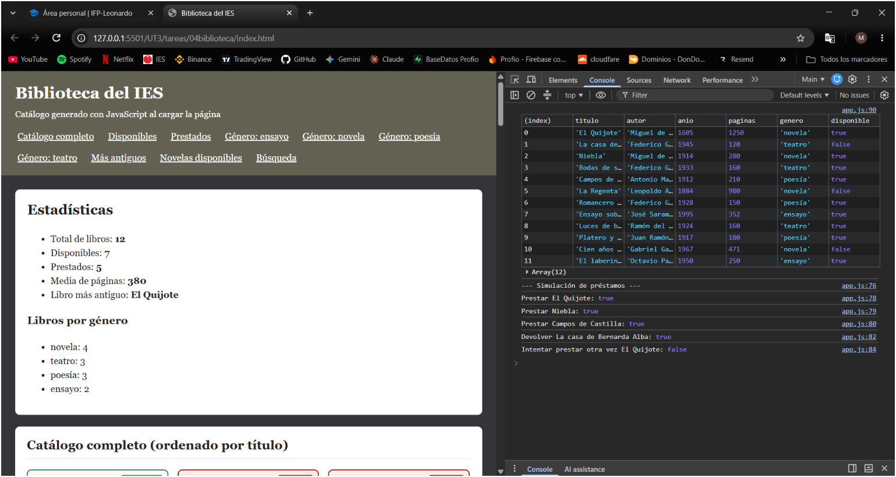
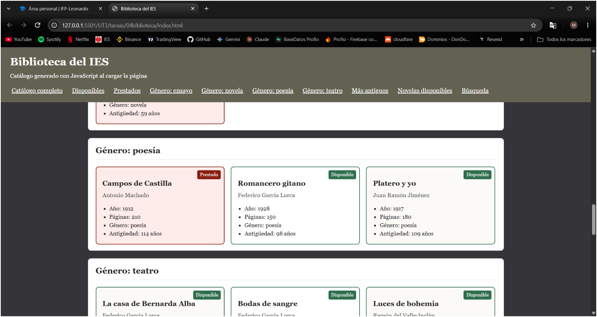
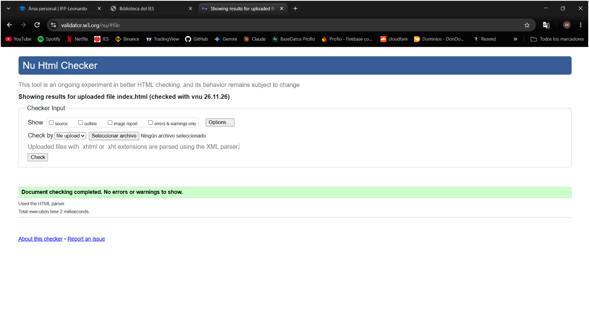

# Biblioteca del IES — Proyecto DEC + DIW

Página web del catálogo de una biblioteca. JavaScript genera todas las vistas
al cargar la página, sin interacción del usuario.

## Cómo abrirlo

1. Abre la carpeta `biblioteca` en VS Code.
2. Usa **Live Server** (los módulos ES no funcionan con doble clic / `file://`).
3. Abre la consola (F12): verás `console.table` y la simulación de préstamos.

## Capturas

### Aplicación y consola

### Validador W3C

## Arquitectura

Esta aplicación se ejecuta **en el cliente** (navegador): HTML, CSS y JavaScript
llegan al ordenador del usuario y el JS pinta las vistas al cargar.

Para que los préstamos se **guardaran de verdad** haría falta un **servidor**
con base de datos y una API que recibiera las operaciones.

Se usa **JavaScript** porque es el lenguaje nativo de los navegadores para
programar el cliente. Otros lenguajes/tecnologías de cliente son TypeScript
(se compila a JS) o WebAssembly.

Los scripts se cargan como **módulos ES** (`type="module"`): se descargan de
forma diferida (como `defer`), respetan el orden de `import` y no crean
variables globales. Por eso necesitan un **servidor local**.

Un lenguaje **interpretado** en el navegador (JS) se ejecuta al momento y es
fácil de depurar, pero el código fuente llega al cliente y suele ser más lento
que un programa **compilado**.

**Herramientas:** VS Code/Cursor, Live Server, DevTools (consola y Sources) y
el validador HTML del W3C.

## Decisiones

1. **Filtros combinados:** primero `filtrarPorGenero("novela")` y después
   `.filter` de disponibles + `.sort` por páginas.

2. **Ordenar sin modificar el original:** `ordenarPor` usa `this.libros.slice()`
   y ordena esa copia.

3. **Conversiones en `cargarDesdeTexto`:** `Number()` convierte año y páginas;
   `toLowerCase() === "si"` convierte el último campo a `boolean`.